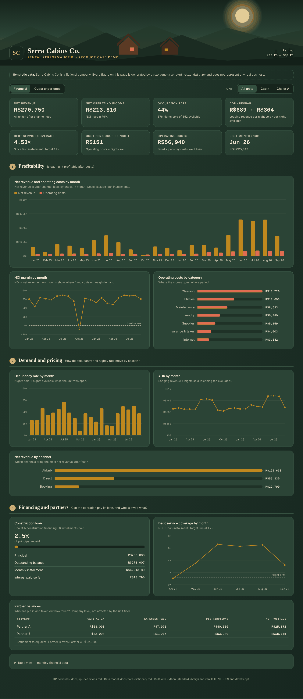
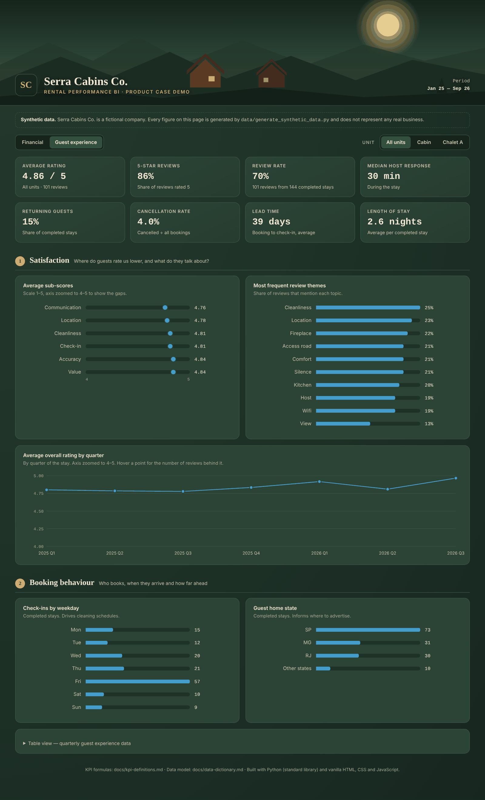
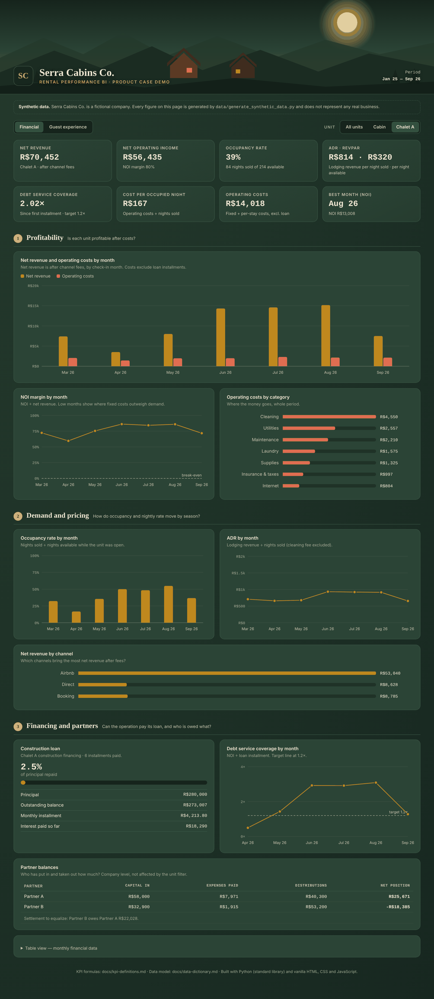

# Rental Performance BI

Product case: a business intelligence product for a small short-term rental operation, with one view for financial health and one for guest experience. Inspired by a real operation I co-own and manage; published here on fully synthetic data for a fictional company, Serra Cabins Co.

**My role:** Product Owner and builder — business questions, data model, KPI definitions, dashboard requirements, AI-assisted development.

> All data in this repository is synthetic, generated by data/generate_synthetic_data.py. It does not represent any real business.

## The problem

The operation grew from one cabin to a multi-unit business, with construction financing and two partners. The numbers that drive its decisions lived in separate spreadsheets: bookings, costs, loan installments, partner contributions. Guest feedback lived in platform reviews. Nobody could answer "are we healthy, and are guests happy?" in one place.

## Questions the product answers

| User | Question | View |
|---|---|---|
| Partners | Is each unit profitable after costs and debt service? | Financial |
| Partners | Who has put in and taken out how much? | Financial |
| Manager | How do occupancy and nightly rate move by season and weekday? | Financial |
| Manager | Which channels bring the most net revenue after fees? | Financial |
| Manager | Where do guests rate us lower, and what do they talk about? | Guest experience |
| Manager | Are we fast enough answering guests? | Guest experience |

## The dashboard

**[Open the live demo](https://brunolsalvadori.github.io/rental-performance-bi/dashboard/)**

A single static page with two views and a unit filter (All units, Cabin, Chalet A). Every KPI recalculates in the browser when the filter changes. The source is [dashboard/index.html](dashboard/index.html); rebuild it with the commands in [Reproduce](#reproduce-the-data-and-the-dashboard).

**Financial view:** profitability, demand and pricing, channels, construction loan and partner balances.

**Guest experience view:** ratings, sub-scores, review themes and booking behaviour.

**Unit filter:** the same financial view for Chalet A only, the unit with construction financing, where debt service coverage is the number that matters.

The visual design comes from the real dashboard I built for the operation. Only the data was replaced: no real figures, names, reviews or listing details are published here.

## Data model

Five tables, joined by `unit`, `booking_id` and month. Full definitions in [docs/data-dictionary.md](docs/data-dictionary.md).

    bookings ----< reviews          (booking_id)
    bookings  --- costs             (unit, month)
    financing --- costs             (unit, month)
    partner_ledger                  (month)

## KPIs

Formulas in [docs/kpi-definitions.md](docs/kpi-definitions.md).

| Financial | Guest experience |
|---|---|
| Occupancy rate | Average overall rating |
| ADR (average daily rate) | Sub-scores: cleanliness, accuracy, check-in, communication, location, value |
| RevPAR | Share of 5-star reviews |
| Net revenue by channel | Review rate |
| Net operating income (NOI) | Median host response time |
| Debt service coverage ratio | Returning guest rate |
| Cost per occupied night | Most frequent review themes |
| Partner balance | Cancellation rate, lead time, length of stay |

## Key product decisions

| Decision | Alternative considered | Why |
|---|---|---|
| Static HTML dashboard | Power BI or Looker Studio | No license, one shareable link for partners, works on a phone |
| Two views: financial and guest experience | One long page | Partners and the manager ask different questions |
| Partner ledger as a first-class table | Notes in a spreadsheet | Settlements between partners were the most disputed number |
| Synthetic data in public | Anonymized real data | Even anonymized, real figures would expose the business |
| Debt service coverage as a headline KPI | Revenue as the headline | With construction financing, cash after the installment is what matters |

## How I worked with AI

I built the product with Claude as the engineering copilot. I acted as the Product Owner: I framed the business questions, designed the data model, defined every KPI, set the dashboard requirements and reviewed each iteration against them.

The [prompts/](prompts/) folder documents that process step by step: the goal of each prompt, what came back, and what I kept or changed and why.

**Stack:** Python (standard library) for data generation · HTML, CSS, JavaScript for the dashboard.

## Repository structure

    data/generate_synthetic_data.py   synthetic data generator (fixed seed)
    dashboard/build_dashboard.py      embeds the synthetic CSVs into the page
    dashboard/template.html           dashboard layout, KPI logic and charts
    dashboard/index.html              built dashboard, open in any browser
    docs/                             data dictionary, KPI definitions, screenshots
    prompts/                          AI prompt log: goal, prompt, output, decision

## Roadmap

- [x] Dashboard demo on the synthetic data
- [x] Host the demo on GitHub Pages so it opens from a link
- [ ] Classify review themes with an LLM instead of fixed labels, with a human-reviewed sample to measure accuracy
- [ ] Occupancy forecast by month to support pricing decisions
- [ ] Alerts when a sub-score or response time drops below a threshold
- [ ] Scenario view: impact of a new unit on NOI and debt coverage

## Reproduce the data and the dashboard

    python data/generate_synthetic_data.py
    python dashboard/build_dashboard.py

No dependencies beyond Python 3. A fixed seed makes the output identical on every run, so the rebuilt dashboard matches the screenshots.
